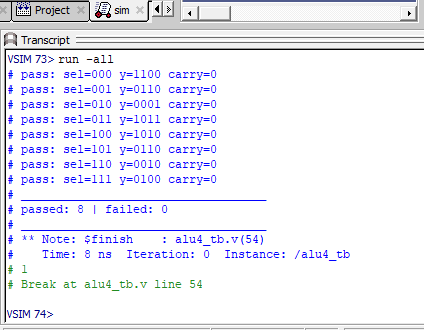

# 4-Bit ALU in Verilog

A 4-bit Arithmetic Logic Unit with 8 operations, verified with a self-checking testbench.

## Operations
| sel | Operation | Result (y) |
|-----|-----------|-----------|
| 000 | ADD       | a + b (with carry) |
| 001 | SUB       | a - b |
| 010 | AND       | a & b |
| 011 | OR        | a \| b |
| 100 | XOR       | a ^ b |
| 101 | NOT       | ~a |
| 110 | SHL       | a << 1 |
| 111 | SHR       | a >> 1 |

## Simulation result
All 8 test cases pass (`passed: 8 | failed: 0`).

## How to run
- **Online:** paste `alu4.v` and `alu4_tb.v` into EDA Playground (SystemVerilog/Verilog)
- **Locally:** compile and run `alu4_tb` in Questa/ModelSim

## Video walkthrough
https://www.instagram.com/monirul.wav/
